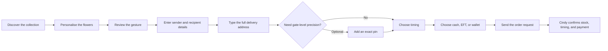
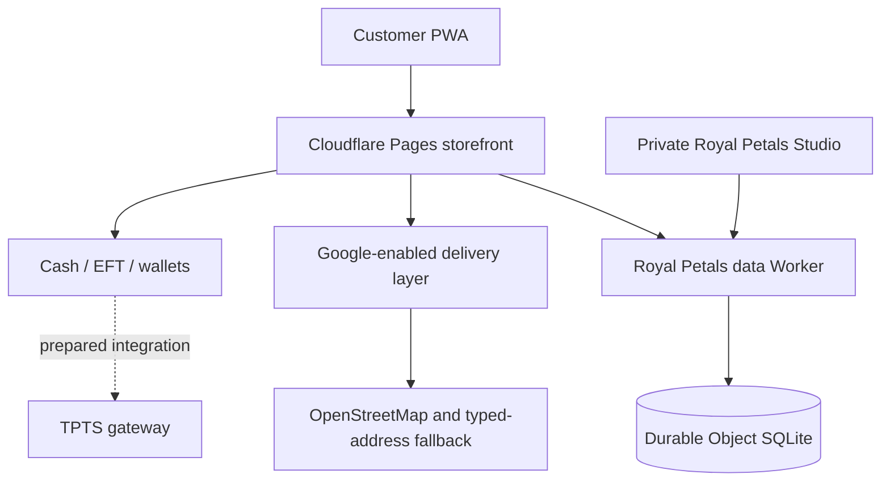

# Royal Petals — A Digital Floristry Experience

An independent public case study for the digital transformation of [Royal Petals Namibia](https://www.instagram.com/royal_petals_nam/), designed and engineered by [SolarSpin Technologies](https://solarspin-namibia.pages.dev/).

[Visit the Royal Petals experience](https://royal-petals.pages.dev/) · [Follow Royal Petals on Instagram](https://www.instagram.com/royal_petals_nam/)

## The house

Royal Petals Namibia was founded by Cindy Mbako in 2019 and is led by directors Cindy Mbako and Theo Amutjira. The brand approaches flowers as expressions of love, appreciation, celebration, and connection—not disposable catalogue items.

The digital brief therefore went beyond putting products online. Royal Petals needed an experience that could carry the theatre of the work, make ordering feel personal, and give the team a practical operating system for stock, sales, fulfilment, clients, rewards, and private enquiries.

## Experience direction

The creative system treats every visit like entering a modern floral salon:

- Deep burgundy, parchment, blush, antique gold, and garden green establish a recognisable house palette.
- Layered architectural scenery, oversized florals, editorial photography, subtle motion, and tactile panels replace flat painted backgrounds.
- A custom petal crest and Royal Petals wordmark create a flexible signature across the storefront, install icon, loading sequence, and admin studio.
- Product imagery keeps deliberate aspect ratios and focal positions so arrangements and presentation boxes remain correctly proportioned.
- Mobile layouts are composed for the viewport rather than reduced from desktop, with safe areas, touch-first controls, full-height panels, and an expressive petal menu.
- The interface remains clear beneath the drama: prices use Namibian dollars, stock states are explicit, and every primary action has a defined destination.

## What was built

### Client experience

- Responsive, installable progressive web app with an offline shell
- Twelve-piece catalogue spanning signature bouquets, sculptural wraps, hatboxes, reveal boxes, keepsake drawers, chocolates, and celebration compositions
- Live availability states, scale and palette choices, add-ons, florist notes, gift messages, and a persistent cart
- Details-first checkout for sender, recipient, full address, unit or office, suburb, date, delivery window, handover instructions, and payment preference
- Optional precision pin after the written address—not a map-gated checkout
- Returning-client profiles with saved recipients and saved delivery places
- Cash, EFT, and wallet order preferences, with TPTS prepared as a future gateway integration rather than presented as active
- The Royal Circle loyalty journey with configurable earning rules, checkout redemption, and automatic credit restoration when an order is cancelled
- Private promotional codes with minimum-spend, usage-limit, expiry, activation, and pause controls
- Concierge-led recommendations and bespoke commission enquiries
- An editorial social journal linked to original Royal Petals posts
- An About experience carrying the company story, founders, standards, and wholesale ambition

### Delivery intelligence

- Debounced Google Places suggestions with curated Windhoek-area and typed-address fallbacks
- Google Routes estimates for driving distance, duration, and delivery pricing when configured
- Reverse geocoding for optional pins and support for a Cloud-styled Google map
- An interactive OpenStreetMap fallback, so address entry and ordering remain usable without Google credentials
- Service-radius safeguards and a concierge handoff for deliveries outside configured zones

Google Maps JavaScript API, Places API (New), Geocoding API, and Routes API are integration points that require restricted production keys. Google Address Validation is intentionally not claimed: Namibia is not currently supported by that product.

### Business operations

- Private Royal Petals Studio with protected owner access
- Stock counts, availability, prices, featured products, and catalogue visibility controls
- Aggregate stock validation, reservation, release, and oversell protection
- Order-line personalisation, confirmed delivery fees, payment state, and fulfilment workflow
- Sales overview, payment split, recent orders, house favourites, and operational alerts
- Client book, lifetime spend, loyalty balances, and CSV export safeguards
- New, contacted, quoted, won, and closed lanes for bespoke enquiries
- Delivery-zone and Royal Circle configuration
- Promotion creation, monitoring, pausing, and reactivation
- Auditable transitions and once-only loyalty settlement

## Journey

## System shape

## Production discipline

The release gate covers:

- Source checks, type checks, linting, and a production build
- Desktop, tablet, and mobile visual inspection
- Media crop, aspect-ratio, empty-space, overflow, and safe-area checks
- Keyboard focus, dialog focus trapping, reduced-motion behaviour, and touch-target checks
- Catalogue, customisation, cart, details-first checkout, optional map, loyalty, promotion, concierge, enquiry, and admin flows
- API smoke checks for catalogue, public configuration, orders, account data, delivery quoting, promotions, and admin authorization
- Live endpoint and deployment checks after the Cloudflare release completes

## Boundaries

- No unverified performance, conversion, revenue, or customer claims
- No production secrets, private application source, or admin credentials in this public repository
- No client media redistributed here; the deployed experience remains the canonical visual presentation
- No claim that Google services or TPTS are active until the required client-controlled credentials and commercial configuration are supplied
- Final catalogue prices, stock, delivery fees, banking details, wallet instructions, contact details, and service hours remain controlled by Royal Petals

## Credits

Client: [Royal Petals Namibia](https://www.instagram.com/royal_petals_nam/) 
Founder & director: Cindy Mbako 
Director: Theo Amutjira 
Creative direction, product design, and engineering: [SolarSpin Technologies](https://solarspin-namibia.pages.dev/)

© Royal Petals and SolarSpin Technologies. All client names, marks, and media remain the property of their respective owners.
