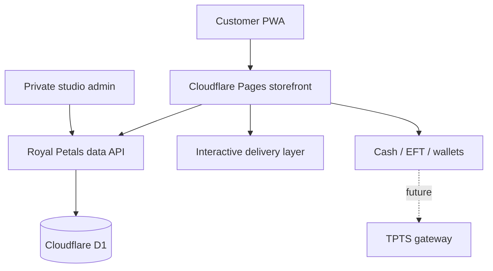

# Royal Petals — A Digital Floristry Experience

An independent public case study for the digital transformation of Royal Petals Namibia, designed and engineered by [SolarSpin Technologies](https://solarspin-namibia.pages.dev/).

[Visit the live experience](https://royal-petals.pages.dev/) · [Royal Petals on Instagram](https://www.instagram.com/royal_petals_nam/)

## The brief

Royal Petals needed more than a conventional catalogue. The goal was to translate the confidence, intimacy, and drama of premium floristry into an online experience where clients can discover available arrangements, personalise a commission, arrange delivery, return easily, and feel looked after throughout the journey.

The operational side mattered just as much: the business needed a private place to manage stock, orders, fulfilment, sales, clients, rewards, and enquiries without flattening the customer experience into a generic store template.

## Experience direction

The creative system treats each visit like entering a modern floral atelier:

- Deep burgundy, blush, parchment, and antique-gold tones create warmth without relying on a flat painted background.
- Editorial photography, layered botanical forms, film-like transitions, and responsive compositions give the page movement and depth.
- A custom Royal Petals monogram and restrained display typography establish a recognisable luxury signature.
- The interface remains intentionally simple: strong product hierarchy, clear actions, readable prices in Namibian dollars, and touch-first controls.
- Mobile layouts are composed for the viewport instead of being reduced desktop screens, including safe areas, thumb reach, full-height panels, and correctly proportioned media.

## What was built

### Client experience

- Responsive, installable progressive web app
- Live product catalogue and availability states
- Arrangement customisation, personal notes, and bouquet enquiries
- Persistent cart and return-client journey
- Cash, EFT, and wallet checkout foundations, with a future TPTS integration seam
- Interactive delivery map and location selection
- Concierge-led product recommendations
- Royal Circle loyalty concept and rewards ledger
- Bespoke commission and occasion enquiry flows
- Integrated social journal connected to original Royal Petals posts

### Business operations

- Private admin corner
- Stock and availability controls
- Order, payment, and fulfilment pipeline
- Sales and performance overview
- Customer and loyalty administration
- Enquiry and bespoke-commission management
- Content and configuration controls

## System shape

## Mobile hardening

The final experience was inspected at 360 × 740, 390 × 844, and 430 × 932 viewport sizes. The work covered:

- Exact media aspect ratios and deliberate crop behaviour
- Safe-area-aware navigation and action bars
- Minimum 44 px touch targets
- Mobile form sizing that avoids unwanted browser zoom
- Full-height product, checkout, concierge, and bespoke panels
- Two-column merchandising where space permits, with a small-screen fallback
- Natural-height social imagery instead of forced, distorted cards
- Reduced-motion support and keyboard-visible focus states
- End-to-end checks across browsing, product customisation, cart, checkout, map, loyalty, concierge, bespoke requests, menu, and footer

## Delivery principles

- No unverified performance or conversion claims
- No production secrets or private source code in this public repository
- No client media redistributed here; the live experience remains the canonical presentation
- Final prices, inventory, delivery policies, payment details, and contact information remain client-controlled business data

## Credits

Client: [Royal Petals Namibia](https://www.instagram.com/royal_petals_nam/) 
Creative direction, product design, and engineering: [SolarSpin Technologies](https://solarspin-namibia.pages.dev/)

© Royal Petals and SolarSpin Technologies. All client names, marks, and media remain the property of their respective owners.
